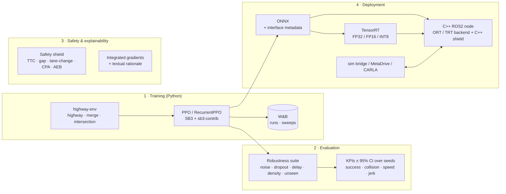
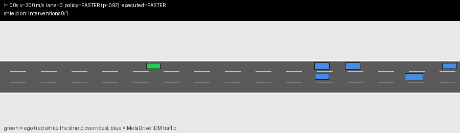
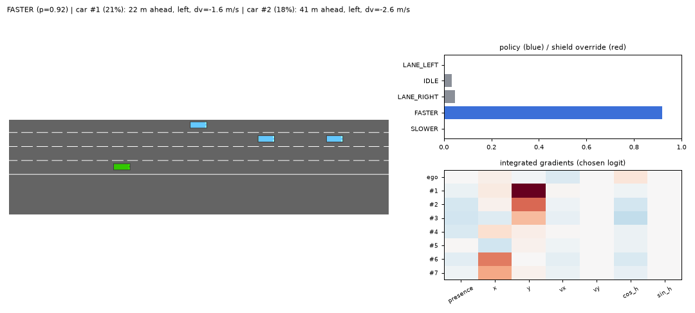

# safe-rl-drive

[](https://utkuakinci.github.io/safe-rl-drive/results/index.html)

**Safe & explainable RL driving agent — from training to real-time deployment.**

PPO / RecurrentPPO driving policies for lane changes, merges and intersections, guarded by an auditable
rule-based safety shield, explained with integrated gradients, tracked in W&B, exported to
ONNX / TensorRT and served by a C++ ROS2 node.



| Layer | What is in the repo | Entry point |
|---|---|---|
| Model development | 3 training scenarios + 2 held-out, unified obs/action contract, PPO vs RecurrentPPO, POMDP variant (velocities hidden) | `safe_rl_drive.training.train` |
| Experimentation | W&B tracking + Bayesian sweeps, driving KPIs, CIs across training seeds, robustness suite | `safe_rl_drive.evaluation.evaluate` |
| Safety & explainability | rule-based shield with per-rule intervention logs, AEB, Python ↔ C++ conformance vectors; integrated-gradients attribution + natural-language rationale + annotated videos | `safe_rl_drive.safety`, `safe_rl_drive.explain.visualize` |
| Deployment & optimisation | ONNX export with parity check, TensorRT FP16/INT8, PyTorch vs ORT vs TRT benchmark, C++ ROS2 node, Docker, CI | `scripts/deploy_pipeline.sh`, `ros2_ws/` |
| Bonus | Active inference (pymdp) vs PPO vs RecurrentPPO; MetaDrive sim-to-sim transfer (+ CARLA script) | `safe_rl_drive.active_inference.experiment`, `sim2sim_demo/`, `carla_demo/` |

---

## Results

> The tables below are generated from `results/` by `scripts/readme_tables.py`; the charts of the
> [full report](results/index.html) by `scripts/report_figures.py`
> ([plain-English version](results/explained.html)).

### Inference backends

`make deploy RUN=runs/highway/rppo/seed_1` (RecurrentPPO actor, LSTM state passed explicitly). p50/p99
host-to-host latency (input copy + inference + output copy), throughput, host and GPU memory, artefact
size, max logit error and action agreement vs PyTorch FP32 on 30 recorded episodes, and closed-loop
success/collision **per backend** over 20 episodes (shield off, so the policy alone is measured).
TensorRT 10.16, INT8 entropy-calibrated on the same recorded on-policy observations.

<!-- results:benchmark:start -->
`results/benchmark_rppo_highway/benchmark.md` — Hardware: `{'platform': 'Windows-10-10.0.26200-SP0', 'processor': 'Intel64 Family 6 Model 141 Stepping 1, GenuineIntel', 'python': '3.11.17', 'threads': 1, 'gpu': 'NVIDIA RTX A2000 Laptop GPU'}`

| Backend | Batch | p50 [µs] | p99 [µs] | Throughput [inf/s] | Host RAM Δ [MB] | GPU mem Δ [MB] | Artifact [MB] | max abs Δlogit | Action agreement | Closed-loop success | Closed-loop collision |
|---|---|---|---|---|---|---|---|---|---|---|---|
| pytorch-cpu-fp32 | 1 | 245.2 | 1025.0 | 3,208 | 116.7 | 0.0 | 2.73 | 0.0e+00 | 100.00% | 15% | 85% |
| pytorch-cpu-fp32 | 32 | 342.1 | 1465.5 | 66,742 | 116.7 | 0.0 | 2.73 | 0.0e+00 | 100.00% | 15% | 85% |
| onnxruntime-cpu-fp32 | 1 | 33.1 | 183.9 | 22,172 | 21.1 | 0.0 | 0.45 | 1.4e-06 | 100.00% | 15% | 85% |
| onnxruntime-cpu-fp32 | 32 | 118.0 | 514.9 | 191,201 | 21.1 | 0.0 | 0.45 | 1.4e-06 | 100.00% | 15% | 85% |
| pytorch-cuda-fp32 | 1 | 880.2 | 2088.3 | 1,038 | 121.0 | 44.0 | 2.73 | 1.6e-05 | 100.00% | 15% | 85% |
| pytorch-cuda-fp32 | 32 | 872.6 | 2046.3 | 32,643 | 121.0 | 44.0 | 2.73 | 1.6e-05 | 100.00% | 15% | 85% |
| pytorch-cuda-fp16 | 1 | 1082.7 | 2249.1 | 842 | 296.3 | 6.0 | 2.73 | 3.5e-03 | 100.00% | 15% | 85% |
| pytorch-cuda-fp16 | 32 | 743.5 | 2089.7 | 34,448 | 296.3 | 6.0 | 2.73 | 3.5e-03 | 100.00% | 15% | 85% |
| tensorrt-cuda-fp32 | 1 | 624.9 | 1733.6 | 1,414 | 100.8 | 46.0 | 0.57 | 1.4e-03 | 100.00% | 15% | 85% |
| tensorrt-cuda-fp32 | 32 | 754.2 | 1784.3 | 40,128 | 100.8 | 46.0 | 0.57 | 1.4e-03 | 100.00% | 15% | 85% |
| tensorrt-cuda-fp16 | 1 | 462.1 | 1589.4 | 1,732 | 0.3 | 34.0 | 0.55 | 1.4e-03 | 100.00% | 15% | 85% |
| tensorrt-cuda-fp16 | 32 | 519.2 | 1604.3 | 51,667 | 0.3 | 34.0 | 0.55 | 1.4e-03 | 100.00% | 15% | 85% |
| tensorrt-cuda-int8 | 1 | 438.7 | 1115.5 | 1,941 | 0.0 | 34.0 | 0.57 | 1.2e-03 | 100.00% | 15% | 85% |
| tensorrt-cuda-int8 | 32 | 514.2 | 1245.6 | 54,973 | 0.0 | 34.0 | 0.57 | 1.2e-03 | 100.00% | 15% | 85% |
<!-- results:benchmark:end -->

**Reading the table.** The actor is tiny (LSTM-128 + one 128-unit layer, 112k parameters), so a single decision is dominated by fixed
overhead, not FLOPs:

- **ONNX Runtime on one CPU thread is the fastest backend at batch 1** (33 µs p50, 7× faster than
  PyTorch eager), with an artefact 6× smaller than the SB3 checkpoint. For a 2 Hz planner on a laptop
  this is the right deployment target.
- On the GPU, every call pays kernel-launch + PCIe copy overhead (~0.4–0.9 ms on this Windows / WDDM
  laptop). Within the GPU backends, TensorRT FP16 / INT8 are ~2× faster than PyTorch CUDA and have the
  lowest p99, and the gap to CPU closes with batching (batch 32: 55k inf/s INT8 vs 33k PyTorch CUDA) —
  the GPU pays off when many agents / scenarios are evaluated in one batch, or when the policy shares a
  GPU-resident perception pipeline.
- **Accuracy:** every backend picks the same action as PyTorch FP32 on 100 % of the recorded
  observations, and closed-loop driving outcomes are identical, so FP16 / INT8 lose nothing measurable
  here (max logit error ≤ 3.5e-3). INT8 is close to FP16 in both speed and error, which suggests TensorRT
  ran most of this small recurrent network in higher precision; a per-layer precision dump
  (`trtexec --dumpLayerInfo`) would confirm it, and INT8 is not worth its calibration step for this model.
- The 15 % / 85 % closed-loop numbers are the under-trained RecurrentPPO **without** the shield (see the
  next table); the point of this column is that they do not change between backends.

### C++ ROS2 node, closed loop

`docker compose run --rm ros2`: ROS2 Humble container, highway-env bridge ↔ C++ component node (ONNX
Runtime C++ API, LSTM state kept in the node, C++ port of the shield), same RecurrentPPO model, 20
episodes. Sources: `results/ros2_closed_loop.json` (bridge) and the node's periodic latency log.

| Measurement | Value |
|---|---|
| gtest (incl. shield conformance against 2400 Python reference vectors) | 8 / 8 passed |
| `bench_inference` ORT C++, RecurrentPPO, 5000 calls | p50 13.0 µs, p99 28.3 µs |
| Node callback (deserialize → inference → shield → publish), 500 steps | p50 157 µs, p99 297 µs |
| Bridge round trip over DDS (publish obs → receive command) | p50 762 µs, p99 1175 µs |
| Closed loop, shield on in C++ | 20 / 20 success, 0 collisions, 22.6 m/s, shield active on 23 % of steps |

The C++ pipeline reproduces the Python evaluation of the same model with the shield on (100 % success,
0 % collisions, 22.2 m/s, 22.8 % interventions), so the shield port and the recurrent-state handling
behave the same outside Python. All latencies are far below the 500 ms decision period (2 Hz).

### PPO vs RecurrentPPO, shield off / on

Nominal conditions; mean and 95 % Student-t CI **across training seeds** (each seed scored on 20
evaluation episodes). Full table incl. jerk: `results/<scenario>/summary.md`. Tables below are written by
`python scripts/readme_tables.py` from `results/<scenario>/summary.csv`.

Training budget for these numbers: 3 seeds, 200k env steps (intersection 400k), CPU laptop, ~6 h total
(`scripts/run_queue.py`, 4 jobs × 4 envs in parallel).

<!-- results:headline:start -->
| Scenario | Agent | Seeds × episodes | Success, shield off | Success, shield on | Collision, shield off | Collision, shield on | Speed off → on [m/s] | Shield interventions |
|---|---|---|---|---|---|---|---|---|
| highway | PPO | 3 × 20 | 55.0% [0.0, 100.0] | 100.0% [100.0, 100.0] | 45.0% [0.0, 100.0] | 0.0% [0.0, 0.0] | 23.2 → 21.5 | 15 % |
| highway | RecurrentPPO | 3 × 20 | 13.3% [0.0, 39.2] | 100.0% [100.0, 100.0] | 86.7% [60.8, 100.0] | 0.0% [0.0, 0.0] | 26.7 → 22.2 | 23 % |
| highway | PPO, velocities hidden | 3 × 20 | 68.3% [32.5, 100.0] | 100.0% [100.0, 100.0] | 31.7% [0.0, 67.5] | 0.0% [0.0, 0.0] | 21.7 → 21.1 | 10 % |
| highway | RecurrentPPO, velocities hidden | 3 × 20 | 15.0% [2.6, 27.4] | 100.0% [100.0, 100.0] | 85.0% [72.6, 97.4] | 0.0% [0.0, 0.0] | 26.2 → 21.8 | 21 % |
| merge | PPO | 3 × 20 | 100.0% [100.0, 100.0] | 100.0% [100.0, 100.0] | 0.0% [0.0, 0.0] | 0.0% [0.0, 0.0] | 20.1 → 19.9 | 7 % |
| merge | RecurrentPPO | 3 × 20 | 86.7% [67.7, 100.0] | 100.0% [100.0, 100.0] | 13.3% [0.0, 32.3] | 0.0% [0.0, 0.0] | 20.9 → 19.6 | 5 % |
| intersection | PPO | 3 × 20 | 75.0% [75.0, 75.0] | 43.3% [24.4, 62.3] | 25.0% [25.0, 25.0] | 23.3% [4.4, 42.3] | 9.0 → 6.2 | 29 % |
| intersection | RecurrentPPO | 3 × 20 | 75.0% [75.0, 75.0] | 38.3% [2.5, 74.2] | 25.0% [25.0, 25.0] | 28.3% [21.2, 35.5] | 9.0 → 6.4 | 30 % |
<!-- results:headline:end -->

### Robustness

Every condition is evaluated with and without the shield (same seeds, same episodes). `unseen:*` = a
scenario the policy was never trained on.

<!-- results:robustness:start -->
**highway** — collision rate, shield off → on

| Condition | PPO: off → on | RecurrentPPO: off → on |
|---|---|---|
| nominal | 45 % → 0 % | 87 % → 0 % |
| delay_1step | 57 % → 0 % | 87 % → 0 % |
| density_x1.5 | 50 % → 0 % | 95 % → 0 % |
| density_x2 | 88 % → 5 % | 100 % → 0 % |
| dropout_0.2 | 35 % → 0 % | 88 % → 0 % |
| noise_0.02 | 53 % → 0 % | 87 % → 0 % |
| noise_0.05 | 73 % → 0 % | 88 % → 0 % |
| noise_0.10 | 87 % → 0 % | 88 % → 0 % |
| unseen:highway-dense | 87 % → 5 % | 100 % → 2 % |
| unseen:intersection | 35 % → 40 % | 38 % → 37 % |
| unseen:merge | 2 % → 0 % | 42 % → 0 % |
| unseen:roundabout | 48 % → 27 % | 57 % → 30 % |

**merge** — collision rate, shield off → on

| Condition | PPO: off → on | RecurrentPPO: off → on |
|---|---|---|
| nominal | 0 % → 0 % | 13 % → 0 % |
| delay_1step | 8 % → 0 % | 33 % → 0 % |
| dropout_0.2 | 8 % → 0 % | 13 % → 0 % |
| noise_0.02 | 7 % → 0 % | 17 % → 0 % |
| noise_0.05 | 15 % → 0 % | 15 % → 0 % |
| noise_0.10 | 22 % → 0 % | 17 % → 0 % |
| unseen:highway | 47 % → 0 % | 32 % → 0 % |
| unseen:highway-dense | 78 % → 0 % | 52 % → 0 % |
| unseen:intersection | 27 % → 20 % | 48 % → 33 % |
| unseen:roundabout | 47 % → 15 % | 72 % → 37 % |

**intersection** — collision rate, shield off → on

| Condition | PPO: off → on | RecurrentPPO: off → on |
|---|---|---|
| nominal | 25 % → 23 % | 25 % → 28 % |
| delay_1step | 25 % → 28 % | 25 % → 27 % |
| density_x1.5 | 42 % → 33 % | 40 % → 32 % |
| density_x2 | 75 % → 37 % | 75 % → 33 % |
| dropout_0.2 | 25 % → 32 % | 25 % → 27 % |
| noise_0.02 | 25 % → 23 % | 25 % → 28 % |
| noise_0.05 | 25 % → 23 % | 25 % → 28 % |
| noise_0.10 | 25 % → 23 % | 25 % → 28 % |
| unseen:highway | 47 % → 3 % | 100 % → 7 % |
| unseen:highway-dense | 67 % → 13 % | 100 % → 17 % |
| unseen:merge | 27 % → 0 % | 88 % → 0 % |
| unseen:roundabout | 57 % → 3 % | 52 % → 12 % |
<!-- results:robustness:end -->

**What these numbers say (and what they don't):**

- **The shield carries safety on highway and merge.** Collisions go to 0 % under nominal conditions,
  σ = 0.10 sensor noise, 20 % missed detections and 1-step actuation delay, and to ≤ 5 % at 2× traffic
  density. The cost is ~2 m/s of mean speed on highway (< 0.5 m/s on merge). The shield also transfers
  to scenarios the policy never saw when they are lane-following (highway → merge: 42 % → 0 %).
- **RecurrentPPO is under-trained at this budget.** On highway it drives faster (26.7 vs 23.2 m/s) and
  collides far more often than PPO without the shield; with the shield it reaches the same 0 %, but only
  because the shield overrides ~22 % of its decisions (PPO: ~15 %). Hiding velocities did not hurt PPO here,
  so this run does not (yet) show the expected benefit of recurrence — an LSTM needs more samples than
  200k steps. With 3 seeds the CIs are wide; the PPO vs "PPO, velocities hidden" gap is not significant.
- **Intersection is a negative result.** All six intersection policies collapsed to "always drive at the
  top target speed" (identical outcomes across seeds, algorithms and observation noise, because the
  evaluation episodes share seeds). They ignore crossing traffic, and the shield cannot fix that: slowing
  down makes the ego miss the 13 s time limit (success drops) while the remaining crashes come from
  side impacts the crossing-conflict rule does not anticipate early enough. Likely fixes, not run yet: a
  larger collision penalty / arrival-only reward, a yield rule in the shield (stop-line + right-of-way)
  and more training steps.
- **Unseen scenarios:** the shield helps in every lane-following transfer, and only partially in
  roundabout (48 % → 27 % for highway-PPO). Crossing traffic (`unseen:intersection`) is not covered.

### Sim-to-sim transfer: MetaDrive

The same ONNX policies and the same shield, **without retraining**, in [MetaDrive](https://github.com/metadriverse/metadrive)
(`sim2sim_demo/metadrive_demo.py`, run in `docker/metadrive.Dockerfile`). What changes: Bullet rigid-body
car dynamics driven by steering / throttle instead of highway-env's kinematic model, MetaDrive's own IDM
traffic (parked per road block, it starts driving when the ego approaches), 3.5 m lanes, procedurally
generated road. What is kept: the observation contract (rebuilt from MetaDrive ground truth, lateral
positions expressed in 4 m training lanes), the 2 Hz meta-actions (mapped to a heading-tracking lane
controller + PI speed controller) and the shield. 3-lane straight road, 40 s episodes, traffic cruise
speed 80 km/h, density 0.3, same 20 seeds for shield off / on.

<!-- results:metadrive:start -->
| Agent (highway-env, 200k steps) | Shield | Episodes | Success | Collision | ↳ after a traffic pile-up | Off-road | Speed [m/s] | Shield interventions |
|---|---|---|---|---|---|---|---|---|
| PPO | off | 20 | 25 % | 75 % | 25 % | 0 % | 19.6 | 0 % |
| PPO | on | 20 | 60 % | 40 % | 35 % | 0 % | 15.8 | 14 % |
| RecurrentPPO | off | 20 | 5 % | 95 % | 15 % | 0 % | 26.5 | 0 % |
| RecurrentPPO | on | 20 | 70 % | 30 % | 25 % | 0 % | 16.5 | 26 % |
<!-- results:metadrive:end -->



*RecurrentPPO, shield on (seed 104). Ego is red while the shield overrides the policy; without the shield
the same seed ends in a collision after ~3 s.*

- **The policies do not transfer on their own**: 75 % (PPO) and 95 % (RecurrentPPO) of the episodes end
  in a collision, mostly within the first 3–10 s. In the episodes we inspected, the ego keeps choosing
  FASTER towards MetaDrive traffic that is slower or still accelerating from standstill — a situation
  highway-env (all cars already near cruise speed) never showed it.
- **The shield transfers**: with the identical rule set and thresholds, collisions drop to 40 % / 30 %,
  and almost all remaining collisions (35 of 40 points, 25 of 30) happen right after MetaDrive traffic
  vehicles crashed into each other within 60 m of the ego — sudden obstacles that a 2 Hz meta-action
  shield plus AEB cannot always stop for (the ego's own braking may also have contributed to some of
  these pile-ups). The price is speed: ~16 m/s instead of ~20–26 m/s, with 14 % / 26 % of decisions
  overridden.
- 20 episodes per cell, so differences of ±15 points are within noise; MetaDrive is also not bit-exact
  between runs. The lane controller was tuned first without traffic (single, double and zig-zag lane
  changes at 15–30 m/s): 0 of 80 episodes ended off-road.

Why not CARLA: the repository still contains `carla_demo/` (same idea, Town04 highway), but CARLA needs
≥ 6–8 GB VRAM and Vulkan; it does not run in Docker on Windows/WSL2 and the test laptop has 4 GB.

### Explainability example

Highway PPO (seed 1) with the shield on, evaluation seed 3: success, 1 shield intervention in 80 decisions.
Left: scene (ego = green). Right, top: action probabilities, blue = executed action, red = shield override.
Right, bottom: integrated-gradients attribution of the chosen action over the 8×7 observation. Top line:
the generated rationale. Full 40 s episode: `results/explain_highway.mp4` (`make explain`).



### Active inference vs PPO vs RecurrentPPO

See [Active inference experiment](#active-inference-bonus) — results below were produced on a laptop CPU.

---

## Quick start

```bash
# Python 3.10-3.12
pip install torch --index-url https://download.pytorch.org/whl/cpu
pip install -e ".[tracking,deploy,active-inference,dev]"

pytest -m "not slow"                  # unit tests (~1 min)
make smoke                            # 2 tiny trainings + ONNX export, end-to-end plumbing check
```

### 1 · Train

```bash
wandb login
python -m safe_rl_drive.training.train --config configs/train/highway_rppo.yaml --all-seeds
python -m safe_rl_drive.training.train --config configs/train/highway_ppo.yaml --seed 0 \
    --set hyperparams.learning_rate=3e-4 total_timesteps=500000
wandb sweep configs/sweeps/highway_rppo.yaml && wandb agent <sweep-id>
```

Runs land in `runs/<scenario>/<name>/seed_<n>/` (`model.zip`, `best_model.zip`, `meta.json`,
`config.yaml`, TensorBoard logs). Configs compose with `extends:`; `--set` overrides any dotted key.

### 2 · Evaluate (robustness × shield)

```bash
python -m safe_rl_drive.evaluation.evaluate --runs runs/highway --suite robustness \
    --shield both --episodes 20 --workers 8 --out results/highway
```

### 3 · Explain

```bash
python -m safe_rl_drive.explain.visualize --model runs/highway/rppo/seed_0 --shield \
    --out results/explain_highway.mp4
```

Every frame shows the simulator, the action distribution (policy choice in blue, shield override in
red), the integrated-gradients heatmap over *vehicles × features*, and a rationale such as:

```
SLOWER (p=0.81) | car #1 (46%): 18 m ahead, same lane, dv=-6.2 m/s | SHIELD: FASTER->SLOWER (front_ttc)
```

### 4 · Deploy

```bash
bash scripts/deploy_pipeline.sh runs/highway/rppo/seed_0 highway     # ONNX -> TRT -> benchmark
docker compose build ros2
docker compose run --rm ros2                                          # bridge <-> C++ node, 20 episodes
```

---

## Design notes

### One interface contract

`envs/spec.py` fixes the observation (8 vehicles × `presence, x, y, vx, vy, cos_h, sin_h`, fixed
normalisation ranges instead of highway-env's lane-dependent defaults) and the 5 meta-actions for every
scenario. The contract is written into the ONNX `metadata_props`, so the ROS2 node and the CARLA demo
check the model they load instead of assuming it. A test asserts that `spec.normalize` reproduces
highway-env's own normalisation bit-for-bit.

### Safety shield

`safety/shield.py` — deterministic, ~150 lines, no learned parts, so it can be specified and argued
about in a safety case.

| Rule | Trigger | Blocks |
|---|---|---|
| `front_ttc` | TTC to in-lane leader < 2.5 s | FASTER, IDLE |
| `front_gap` | gap < 4 m + 0.6 s · v | FASTER (IDLE below 4 m) |
| `crossing_conflict` | constant-velocity closest approach < 3 m within 2.5 s (merging / crossing traffic) | FASTER, IDLE |
| `lc_gap`, `lc_ttc` | target lane occupied or closing leader/follower | that lane change |
| AEB | TTC < 1.5 s | commands an emergency brake beyond the meta-action space |

* It reads a **separate safety channel** (ego-frame metric distances and velocities), not the policy's
  normalised and possibly corrupted input, mirroring a separately validated perception path. Sensor
  noise in the robustness suite therefore degrades the policy, not the shield.
* It sits **inside** the actuation delay wrapper, i.e. it vets the command that is actually executed.
* If an action is unsafe it falls back to the **most probable safe action** under the policy, then to
  a fixed order; SLOWER is never blocked (minimal-risk manoeuvre).
* Interventions are logged per rule and per transition (`FASTER->SLOWER`) to W&B and the eval tables.
* The C++ port (`ros2_ws/src/rl_policy_node/src/safety_shield.cpp`) is pinned to the Python reference
  by 2400 conformance vectors from real rollouts and synthetic edge cases
  (`scripts/gen_shield_vectors.py`), checked from both sides (pytest + gtest).
* Sanity check: an always-FASTER policy collided in 6/6 highway and 6/6 merge episodes without the
  shield and in 0/6 with it (the highway case is also a slow test).

Known limitation: the corridor geometry is lane-aligned, so the rules are strongest on highway and
merge. In the intersection and roundabout scenarios curved lanes make the corridor approximation coarse;
a map-aware conflict-zone rule is the next step.

### Explainability

`explain/attribution.py` — integrated gradients from an *empty-road* baseline (completeness is unit-
tested: attributions sum to Δlogit), aggregated per vehicle and translated back into metres and m/s
via the spec. For the LSTM policy the hidden state is held fixed and attribution is w.r.t. the current
frame. Shield reasons are appended to the rationale, so each decision carries *why the policy wanted
it* and *why it was or wasn't executed*.

### Why RecurrentPPO

With full kinematics the problem is close to Markov, so PPO and RecurrentPPO should perform about the
same. The `*_pomdp` configs hide all velocities: closing speeds then have to be inferred from position
history, which a feed-forward policy cannot do. The interesting comparison is the gap between these two
settings, plus how each degrades under noise and missed detections (memory as implicit filtering).

### Deployment

* The exported actor has explicit `h_in/c_in → h_out/c_out` state I/O; episode resets are the caller's
  job. A test checks the exported LSTM step against SB3's own rollout over a full episode.
* TensorRT INT8 is calibrated on **on-policy** observations (`collect_obs`); random inputs would give
  meaningless activation ranges.
* The C++ TensorRT backend keeps the LSTM state on the GPU (device-to-device copy), uses pinned host
  buffers and does no heap allocation on the hot path.
* The ROS2 message carries policy observation, safety observation and the episode-start flag in **one**
  `Float32MultiArray`, so both views always belong to the same simulation step without timestamp sync.
* CPU numbers use one thread on purpose: that is the realistic budget on a shared real-time ECU and
  gives stable p99s.

### CI (`.github/workflows/ci.yml`)

`ruff` lint/format → unit tests → slow tests (shield closed loop, smoke training) → smoke pipeline
(train PPO + RecurrentPPO, evaluate, export to ONNX with parity check, CPU benchmark into the job summary)
→ ROS2 Humble container: `colcon build`, gtest (shield conformance), C++ inference micro-benchmark and
a **closed-loop launch** of bridge + C++ node.

---

## Active inference (bonus)

`active_inference/` — a 3-lane POMDP: a stalled car sits in an unknown lane, and a detector reports its
lane with an accuracy that rises from 50 % (5 steps away) to 75 % (1 step away). One reading is never
enough; evidence has to be accumulated. The pymdp agent is **given the generative model** and selects
actions by minimising expected free energy (pragmatic + epistemic value); PPO and RecurrentPPO learn
from reward. Test conditions: nominal detector and a degraded detector that the agents have never seen.

```bash
python -m safe_rl_drive.active_inference.experiment --budgets 2000 10000 50000 --seeds 0 1 2 --episodes 300
```

Crash rate over 300 evaluation episodes (PPO / RecurrentPPO: mean ± std over 3 training seeds; the
active-inference agent is deterministic given its model). Laptop CPU, `results/active_inference/`.

| Agent | Training steps | Crash rate, nominal detector | Crash rate, degraded detector | Lane changes / episode | Decision time |
|---|---|---|---|---|---|
| Active inference (pymdp, EFE, horizon 2) | **0** | **6.7 %** | **12.0 %** | 1.85 | 8.5 ms |
| PPO | 2 k | 21.4 ± 11.1 % | 25.6 ± 8.4 % | 1.38 | 0.36 ms |
| PPO | 10 k | 9.4 ± 1.7 % | 15.7 ± 2.3 % | 2.51 | 0.37 ms |
| PPO | 50 k | 8.3 ± 1.5 % | 13.9 ± 1.8 % | 2.36 | 0.32 ms |
| RecurrentPPO | 2 k | 24.2 ± 10.9 % | 28.2 ± 7.2 % | 1.28 | 0.87 ms |
| RecurrentPPO | 10 k | 8.0 ± 1.2 % | 15.8 ± 3.2 % | 1.90 | 0.77 ms |
| RecurrentPPO | 50 k | 7.0 ± 0.9 % | 13.8 ± 2.2 % | 2.34 | 0.82 ms |

Chance level is ~33 %. Reading:

* **Sample efficiency.** With a correct generative model, active inference is safer than both RL agents
  even after 50 k samples. That is the expected outcome; the real question it raises is where a good
  generative model comes from in driving.
* **Memory.** Only RecurrentPPO reaches the active-inference level. Feed-forward PPO plateaus a little
  higher, because a single detector reading is wrong 25 % of the time and PPO cannot accumulate evidence.
  The LSTM learns an implicit belief state, while the active-inference agent keeps an explicit one.
* **Distribution shift.** All agents roughly double their crash rate under the unseen, worse detector.
  The active-inference agent keeps its (now mis-specified) likelihood model and does not degrade more
  gracefully than the RL agents.
* **Cost.** Expected-free-energy planning is about 10–25× slower per decision than a policy forward pass
  and grows exponentially with the planning horizon. That argues for a hybrid: amortise EFE planning
  into a policy network, or use active inference for the slow tactical layer only.

---

## Repository layout

```
configs/            training configs (extends-inheritance), shield config, W&B sweeps
src/safe_rl_drive/
  envs/             obs/action contract, scenarios, metrics / noise / delay / masking wrappers
  training/         train CLI, driving-KPI eval callback, shield logging
  evaluation/       rollouts, robustness suite, CI aggregation, eval CLI
  safety/           safety channel, shield, gym wrapper (+ AEB actuation)
  explain/          integrated gradients, rationale, episode videos
  deploy/           ONNX export, TensorRT build, backends, obs collection, benchmark
  active_inference/ lane POMDP, pymdp agent, comparison experiment
ros2_ws/src/
  rl_policy_node/   C++: ORT/TRT backends, shield port, policy node, gtest, launch, micro-benchmark
  rl_sim_bridge/    Python: highway-env <-> ROS2 lock-step bridge
sim2sim_demo/       MetaDrive sim-to-sim transfer test with the same ONNX artefact + shield
carla_demo/         CARLA 0.9.15 variant (needs a CARLA server / >= 6 GB VRAM, not run here)
docker/             train (CPU), trt (CUDA/TensorRT), ros2 (Humble + ORT), metadrive images
docs/ROADMAP.md     4-week plan and status
results/index.html  full report (charts: scripts/report_figures.py), explained.html = plain English
```
